<h1 align="center">Eight+ · Your Eight Sleep Pod, run by Home Assistant</h1>

<p align="center">
  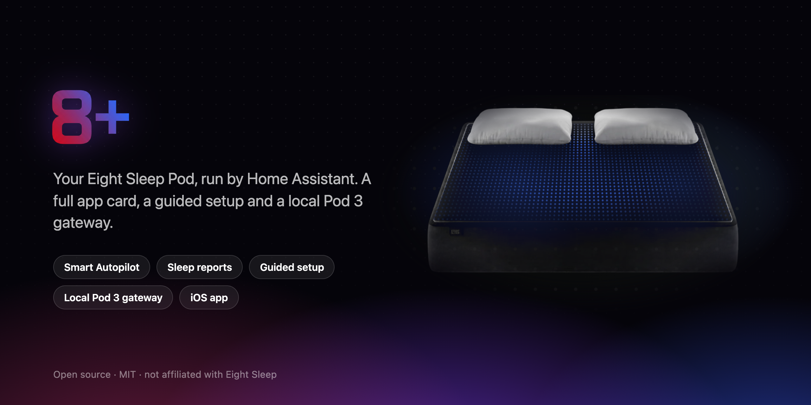
</p>

<p align="center">
  <a href="https://github.com/nexon3223/eight-plus/actions/workflows/test.yml"></a>
  <a href="LICENSE"></a>
  
  <a href="#3-recommended-get-card-updates-through-hacs"></a>
  <br>
  
  
  
  
</p>

> **Independent project.** Eight+ is not affiliated with, endorsed by or supported by Eight Sleep. "Eight Sleep"
> and "Pod" are their trademarks. Eight+ does not contain or redistribute Eight Sleep's firmware or app. The
> optional Pod gateway needs **root on your Pod**, which may void your warranty — that part is entirely your call.
> The gateway builds on [free-sleep](https://github.com/throwaway31265/free-sleep)'s rooting guide and biometrics
> code; see [Credits](#credits) and [Third-party notices](THIRD_PARTY_NOTICES.md).

> [!WARNING]
> **Sleep data is experimental.** Sleep reports (scores, time asleep, stages, HRV and so on) don't really work
> reliably yet and aren't very accurate. Treat the numbers as rough estimates, not medical or sleep-tracking data.
> Bed control, schedules and Autopilot don't depend on them.

---

## ✨ Feature highlights

<p align="center">
  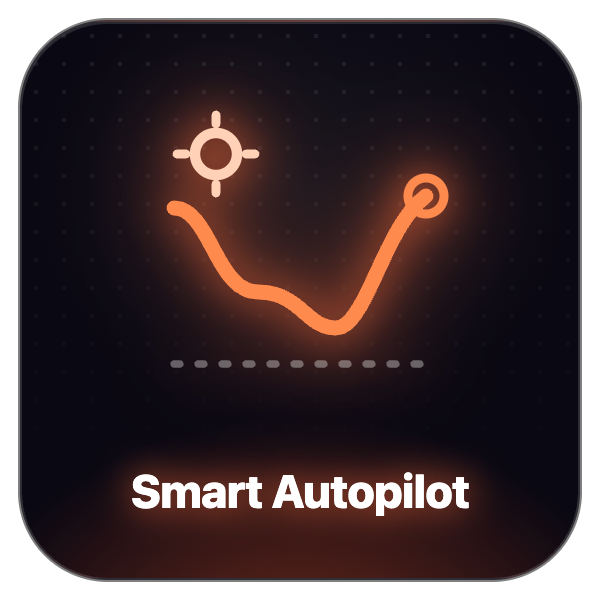
  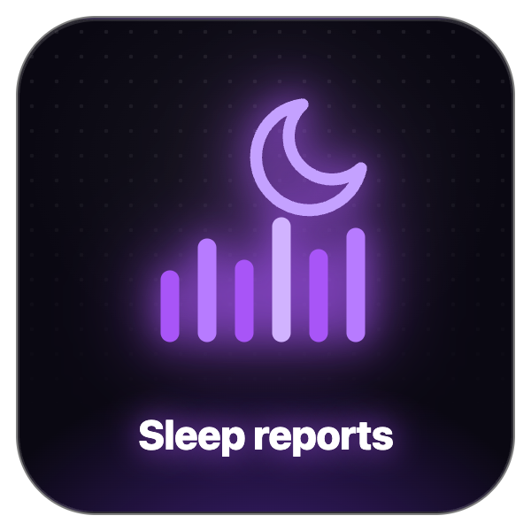
  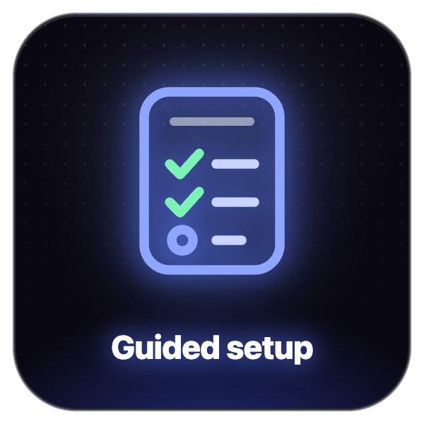
  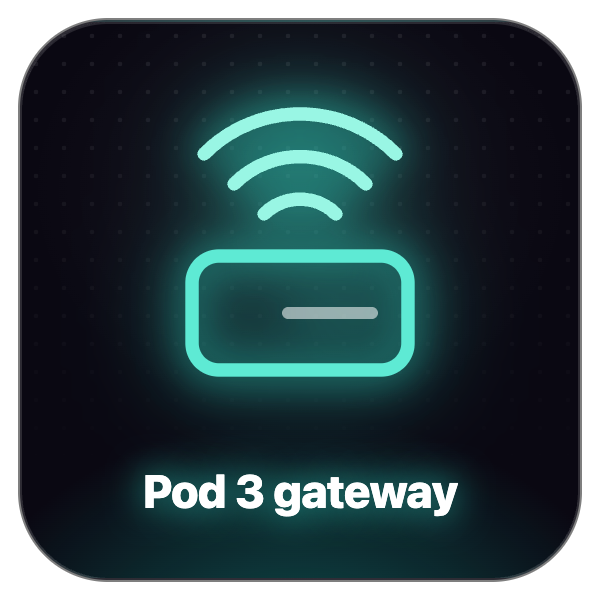
  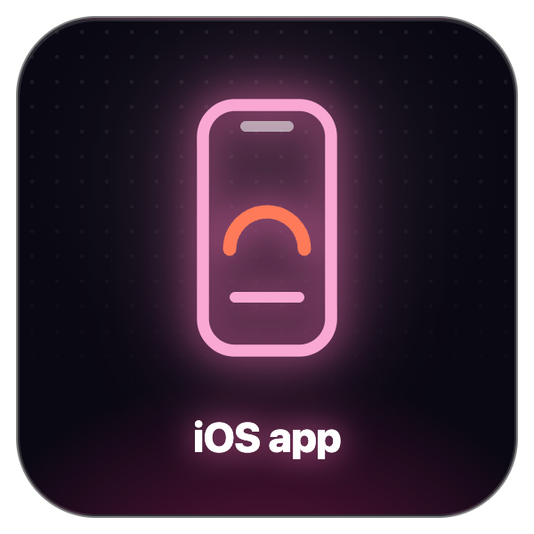
</p>

- **Smart Autopilot.** Seven overnight temperature phases that move with the outside forecast, your bedroom's
  temperature and humidity, the season and how fast the bed is actually heating. Every input can be switched off
  and every offset is a helper you can tune.
- **Sleep reports.** A 0–100 score, time asleep, efficiency, resting heart rate, HRV, breathing, an estimated
  hypnogram and 30 nights of history. They're computed on your own Home Assistant box, with no subscription.
  *Experimental: not very accurate yet — see the note above.*
- **Guided setup.** A Home Assistant app (formerly called an add-on) that finds your Pod and asks a few questions.
  It then writes every helper, schedule, alarm, automation and notification for you, and shows you each file
  before it touches anything.
- **Pod 3 gateway.** Local, instant control and live vitals for a Pod 3 on its stock firmware, over MQTT.
- **iOS app.** A native SwiftUI app with Home Screen widgets and Live Activities. Sideloaded — see [below](#4-ios-app--native-sideloaded).

---

## What's in this repo

Eight+ is four pieces. You can use the card on its own, or let the Home Assistant app set up everything.

| | Piece | What it is | Where |
|---|---|---|---|
| 1 | **Eight+ card** | The whole Pod app in one Lovelace card | [`eight-sleep-card.js`](eight-sleep-card.js) (HACS) |
| 2 | **Eight+ Home Assistant app** | Guided setup, Autopilot, schedules, alarms, notifications, sleep reports, the Pod app | [`eight_plus/`](eight_plus/) |
| 3 | **Pod 3 gateway** | Small services that run *on* a rooted Pod 3 and publish it to Home Assistant | [`gateway/`](gateway/) |
| 4 | **iOS app** | Native iPhone app, Home Screen widgets and Live Activities | sideloaded `.ipa` |

### 1. The Eight+ card

<p align="center">
  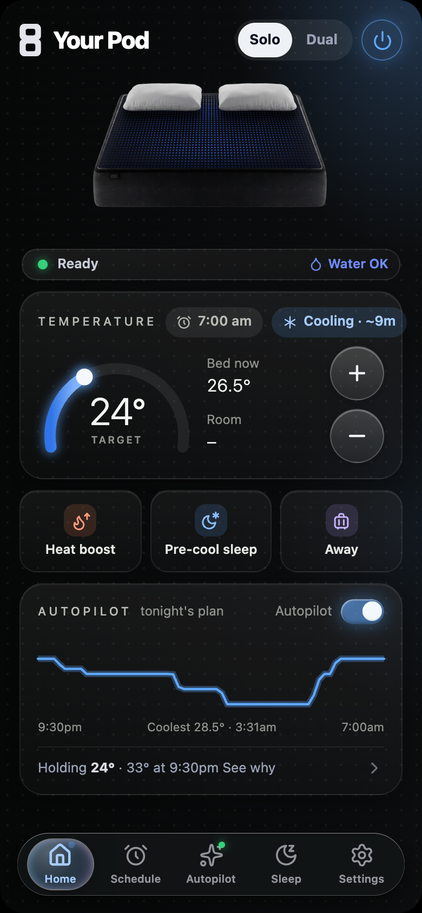
  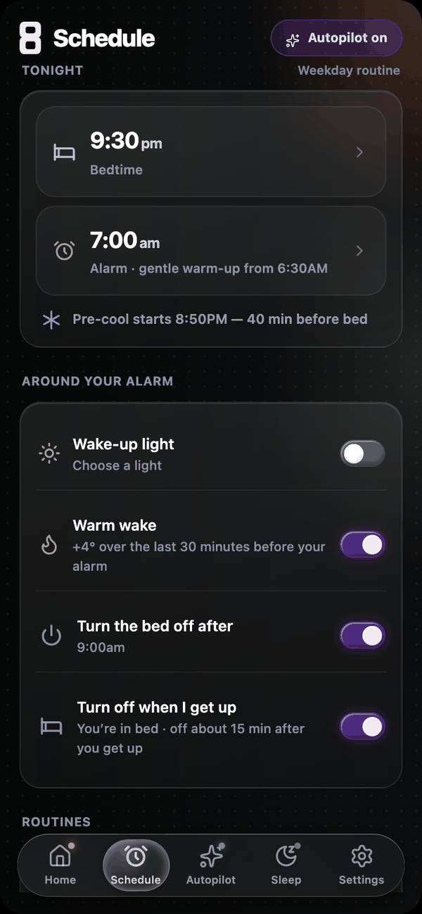
  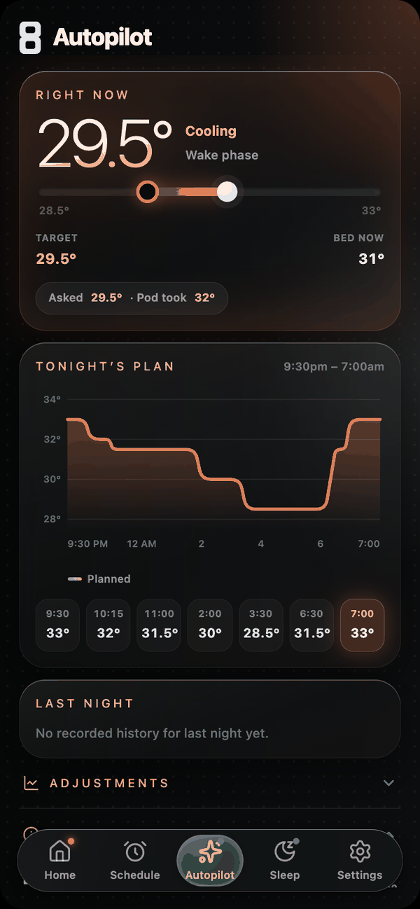
  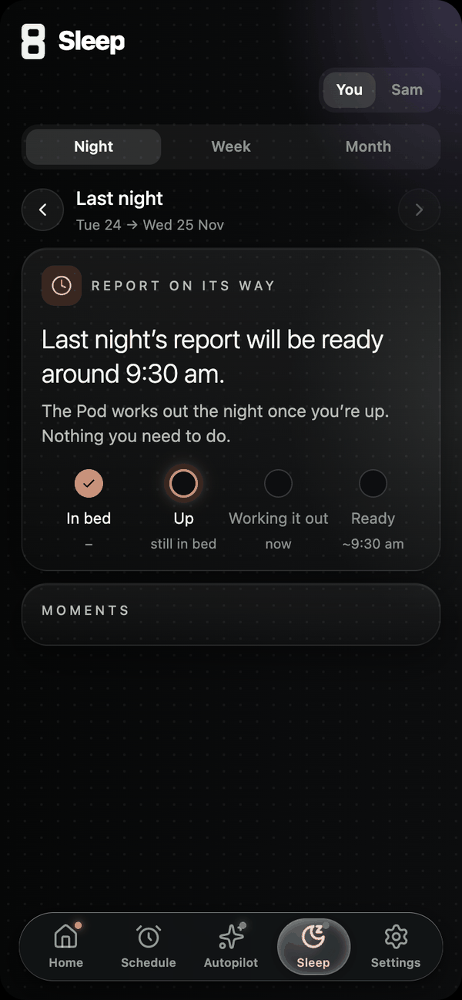
</p>

The card has five tabs:

- **Home** — the bed glowing with its temperature, dual-zone control, Heat boost, Pre-cool sleep, Away and live vitals.
- **Schedule** — tonight's bedtime and alarm, warm wake, a wake-up light, turn-off-after and off-when-you-get-up.
- **Autopilot** — what it's doing right now, tonight's plan, and *why* it chose each temperature.
- **Sleep** — last night, week and month.
- **Settings** — the rest.

It works with any of the three ways a Pod can reach Home Assistant. Set `source:` and one `entity`, and the
card fills in everything else:

| | **Eight Sleep cloud** | **free-sleep** | **Eight+ Pod gateway** |
|---|---|---|---|
| What it is | The Pod as it came, via Eight Sleep's servers | Community firmware on the Pod | Stock firmware + Eight+ services on the Pod |
| Needs | lukas-clarke's [`eight_sleep`](https://github.com/lukas-clarke/eight_sleep) integration (HACS) | [free-sleep](https://github.com/throwaway31265/free-sleep) + Mrtenz's [hass-free-sleep](https://github.com/Mrtenz/hass-free-sleep) | A rooted **Pod 3** + [`gateway/`](gateway/) |
| Control | Cloud (a few seconds of lag) | Local, instant | Local, instant |
| Sleep reports | ✓ | ✓ | ✓ (highest fidelity) |
| Pod health, water temps, bed vibration | – | – | ✓ |

```yaml
type: custom:eight-sleep-card
layout: v2
source: gateway              # cloud | freesleep | gateway
entity: climate.eight_sleep_pod_left
```

| `source` | `entity` example | Filled in |
|---|---|---|
| `cloud` | `climate.alex_s_eight_sleep_side_climate` | bed temperature, bed state, side, next alarm |
| `freesleep` | `climate.pod_4_right_temperature` | presence, vitals, water, priming, prime, partner side |
| `gateway` | `climate.eight_sleep_pod_left` | presence, vitals, water temps, Pod health, partner side |

For a two-sleeper bed, point a second card at the other side's climate entity. Without the Home Assistant app,
any feature whose helpers don't exist simply hides. Every option is documented at the top of `eight-sleep-card.js`.

### 2. The Eight+ Home Assistant app setup wizard

<p align="center">
  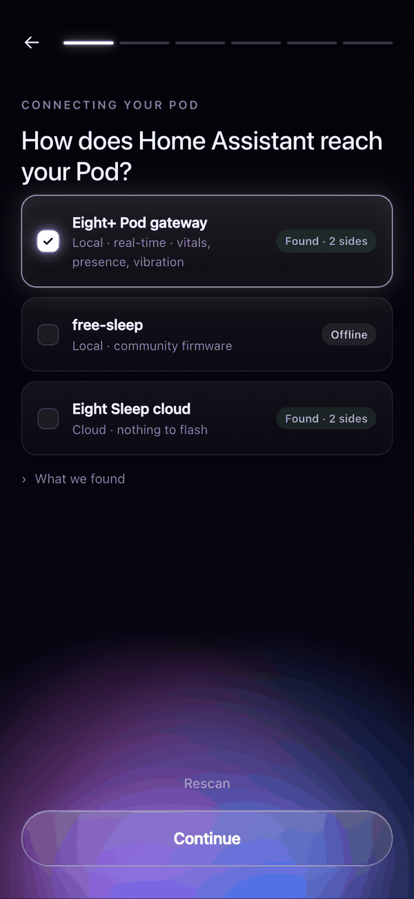
  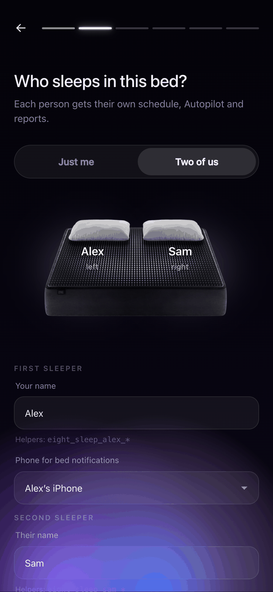
  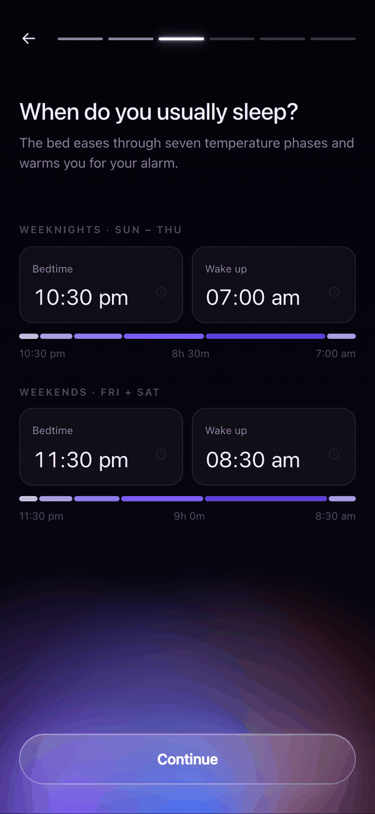
  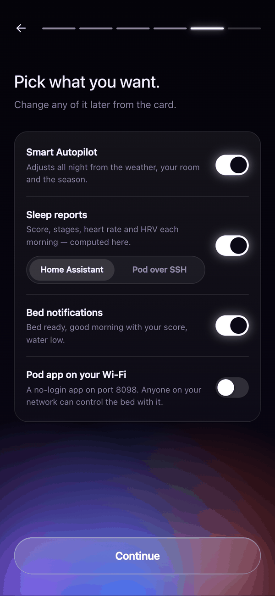
  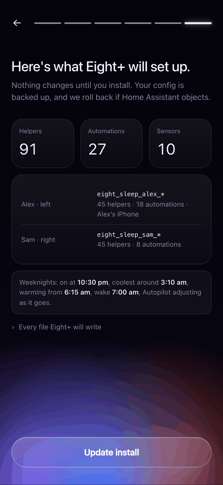
</p>

Open **Eight+** from the sidebar and answer a few questions:

1. **Connect.** Eight+ finds your Pod by matching each integration's own unique IDs, so renamed entities are
   fine. It shows exactly which entities it will use.
2. **People.** Just you or two of you. Tap your half of the bed and pick a phone for notifications.
3. **Routine.** Weekday and weekend bedtimes and wake times. The seven Autopilot phases are laid out across your night.
4. **Your room.** Weather, bedroom temperature and humidity sensors (suggested for you), and an optional wind-down scene.
5. **Features.** Smart Autopilot, sleep reports, bed notifications and the Pod app.
6. **Review.** Every number and every file Eight+ will write, before anything happens.

Then **Install**. Eight+ generates one package per sleeper in `packages/eight_plus/`:

- **Helpers** — bedtime and wake per day type, Autopilot offsets, temperatures and switches.
- **Schedule automations** — bed on at bedtime, pre-cool before bed, warm wake before your alarm, and the bed off
  after your alarm or when you get up.
- **Smart Autopilot** — the overnight phase model, as template sensors and one automation.
- **Safety nets** — a boost failsafe, auto-off and away mode.
- **Notifications** *(optional)* — bed ready, goodnight, good morning with your score and water low, with one-tap
  Warmer / Cooler / Boost buttons.
- **A sunrise light** and **an Eight+ dashboard** with the card already on it.

It backs up `configuration.yaml` and has Home Assistant **check the config** before restarting. If the check
fails, it rolls back on its own. Values you change later are never overwritten.

<p align="center">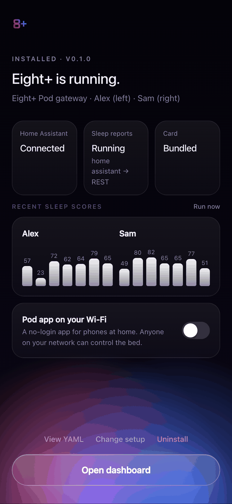</p>

After install, the panel becomes a home screen. It shows:

- connection status for Home Assistant, sleep reports and the card
- a switch for the **Pod app**, a no-login version of the card for phones on your Wi-Fi (its proxy can only
  see the bed)
- **View YAML**, **Change setup** and **Uninstall**

### 3. The Pod 3 gateway — local control on stock firmware

The gateway is **not replacement firmware**. Eight Sleep's own control software keeps running on the Pod, and the
gateway listens in rather than replacing it. **Don't count on the Eight Sleep app, though.** It doesn't work on
the maintainer's Pod, and nobody has tested it on a Pod that's still paired to an Eight Sleep account. Plan on
Home Assistant being how you control the bed. Four small services on the Pod listen to it and publish to Home Assistant
over MQTT:

| Service | What it does |
|---|---|
| [`franken-proxy`](gateway/franken-proxy/) | Sits between the Pod's `frankenfirmware` and `dac`, relays every message unchanged, and adds local heat/level commands → `climate.eight_sleep_pod_left/right`, water low, priming, prime, bed vibration |
| [`biometrics-tap`](gateway/biometrics-tap/) | Runs **free-sleep's biometrics code** over the Pod's own raw sensor stream, read-only → presence, heart rate, HRV, breathing, water and room temperature |
| [`watchdog`](gateway/watchdog/) | Health checks and a self-repair ladder → Pod health sensor, restart/reboot buttons |
| [`led`](gateway/led/) *(optional)* | The front LED as an RGB light |

<details>
<summary><strong>Every Home Assistant entity the gateway creates (37)</strong></summary>

All of them appear on one **Eight Sleep Pod** device in Home Assistant, through MQTT discovery. `{side}` is `left` or `right`. If you rename an entity, Eight+ still finds it by its unique ID.

**Control — `franken-proxy`**

| Entity | What it is |
|---|---|
| `climate.eight_sleep_pod_left / _right` | Each side: off / heat_cool, target 9–45 °C, current bed temperature |
| `binary_sensor.eight_sleep_pod_water_low` | Water tank needs filling |
| `binary_sensor.eight_sleep_pod_priming` | Pod is priming |
| `button.eight_sleep_pod_prime` | Start a prime |
| `button.eight_sleep_pod_{side}_vibrate` | Vibrate that side of the bed |
| `button.eight_sleep_pod_{side}_vibrate_stop` | Stop the vibration |

**Biometrics — `biometrics-tap` (per side)**

| Entity | What it is |
|---|---|
| `binary_sensor.eight_sleep_pod_{side}_presence` | Someone is in bed |
| `sensor.eight_sleep_pod_{side}_heart_rate` | Heart rate (bpm) |
| `sensor.eight_sleep_pod_{side}_hrv` | Heart rate variability (ms) |
| `sensor.eight_sleep_pod_{side}_breathing_rate` | Breathing rate (breaths/min) |
| `sensor.eight_sleep_pod_{side}_present_for` | Minutes in bed this time |
| `sensor.eight_sleep_pod_{side}_movement_30m` | Movement over the last 30 minutes |
| `sensor.eight_sleep_pod_{side}_water_temp` | Water temperature for that side (°C) |
| `sensor.eight_sleep_pod_{side}_vitals_age` | Seconds since the last vitals reading *(diagnostic)* |

**Biometrics — `biometrics-tap` (whole Pod)**

| Entity | What it is |
|---|---|
| `sensor.eight_sleep_pod_room_temperature` | Room temperature (°C) |
| `sensor.eight_sleep_pod_room_humidity` | Room humidity (%) |
| `sensor.eight_sleep_pod_heatsink_temperature` | Heatsink temperature *(diagnostic)* |
| `sensor.eight_sleep_pod_control_board_temperature` | Control board temperature *(diagnostic)* |
| `binary_sensor.eight_sleep_pod_sensor_stream` | The raw sensor stream is flowing *(diagnostic)* |
| `sensor.eight_sleep_pod_raw_file` | The sensor file being read *(diagnostic)* |

**Health — `watchdog`**

| Entity | What it is |
|---|---|
| `sensor.eight_sleep_pod_health` | ok / degraded / recovering / error / rebooting, with every check as attributes |
| `sensor.eight_sleep_pod_health_summary` | One-line summary *(diagnostic)* |
| `button.eight_sleep_pod_reboot` | Reboot the Pod |
| `button.eight_sleep_pod_restart_control` | Restart the control services |
| `switch.eight_sleep_pod_auto_repair` | Let the watchdog repair problems by itself |

**Front LED — `led` *(optional)***

| Entity | What it is |
|---|---|
| `light.eight_sleep_pod_front_led` | The Pod's front LED: RGB colour, brightness and effects |

</details>

> ⚠️ **Tested on Pod 3 only.** It was developed and run nightly on one Pod 3 (model 10503, SD-card variant). It has
> not been tried on Pod 4 or 5, where the hardware and firmware differ. If you have a Pod 4 or 5, use free-sleep
> or the cloud backend.

> ⚠️ **A firmware update from Eight Sleep may remove the gateway.** The installer doesn't block Eight Sleep's
> updater. It hasn't been tested with an update. An update that replaces the Pod's system files would most likely
> undo the `frank.sh` change and remove the gateway services, and possibly root access too. If the Eight+ entities
> stop updating after a Pod update, check over SSH and re-run the installer. Your Home Assistant side is unaffected.

Getting root uses the **same process free-sleep uses**. Follow [free-sleep's installation
guide](https://github.com/throwaway31265/free-sleep/blob/main/INSTALLATION.md) until you can SSH in, then stop
there and run the gateway's one-shot installer instead of free-sleep's. Unlike free-sleep, don't stop or
disable any of the Pod's own services. Full steps, a side-by-side with free-sleep and why it exists are in
[`gateway/README.md`](gateway/README.md#how-this-differs-from-installing-free-sleep).

### 4. iOS app — native, sideloaded

<p align="center">
  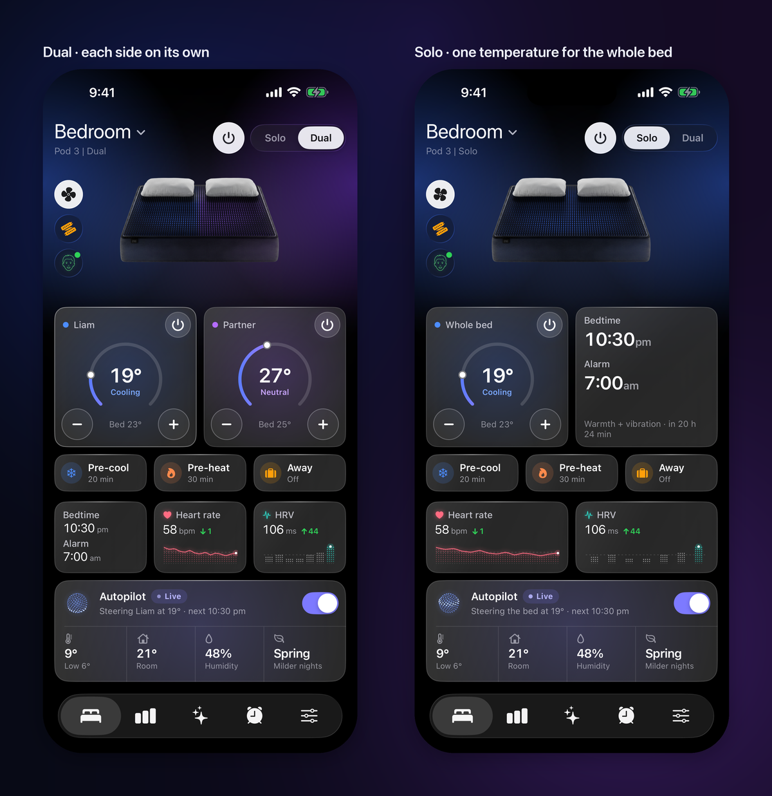
</p>

Eight+ has a native iPhone app. It signs in to your own Home Assistant. It isn't on the App Store or TestFlight, so
you install it by **sideloading** the `.ipa` (for example with AltStore, Sideloadly or Feather).

**[Download the app (unsigned `.ipa`)](https://github.com/nexon3223/eight-plus/releases/latest)** from the latest
release, then sign it and install it with your sideloading tool. On first launch, sign in with your Home Assistant
login or a long-lived access token. The app finds your Pod's entities by itself.

> **Widgets, Control Centre controls and Live Activity buttons need a shared sign-in.** A sideloaded app has no
> App Group unless your signing tool adds one, so the widget extension can't see the app's login. If they show
> no data, the app itself still works fully.

- **Launches instantly.** It's native SwiftUI, not a web page in a wrapper, so it opens straight away and stays smooth with no lag.
- **Bed animations.** The bed animates as each side heats or cools.
- **Solo and dual temperature control.** One temperature for the whole bed, or each side on its own.
- **Cooling and heating timers.** Pre-cool or pre-heat the bed for as long as you choose.
- **Integrated Autopilot.** Turn Autopilot on or off and adjust it from the app.
- **Toggles and custom chips.** Pick entities from your Home Assistant and add them to the Home screen as chips.
- **Alarm and schedule.** Bedtimes and wake-ups, with heat-alarm and vibration-alarm toggles. Vibration alarms only work through the Pod 3 gateway's local MQTT bridge.
- **Sleep statistics.** *Still a work in progress.*
- **Apple Health import.** Send each night to Apple Health: time in bed and asleep, resting heart rate, HRV,
  breath rate, overnight heart rate and estimated stages. Choose how much (Off, Time asleep, Sleep and heart,
  Everything, or your own mix). Re-sending a night replaces it rather than doubling it. Same accuracy caveat as
  the sleep reports applies.
- **Pod settings.** Watchdog, subsystems, Pod light control and developer settings.
- **Live Activities.** See the Pod on your Lock Screen and in the Dynamic Island.
- **Native iOS widgets.** Small, medium and large Home Screen widgets, with ± buttons that work right from the widget.

<p align="center">
  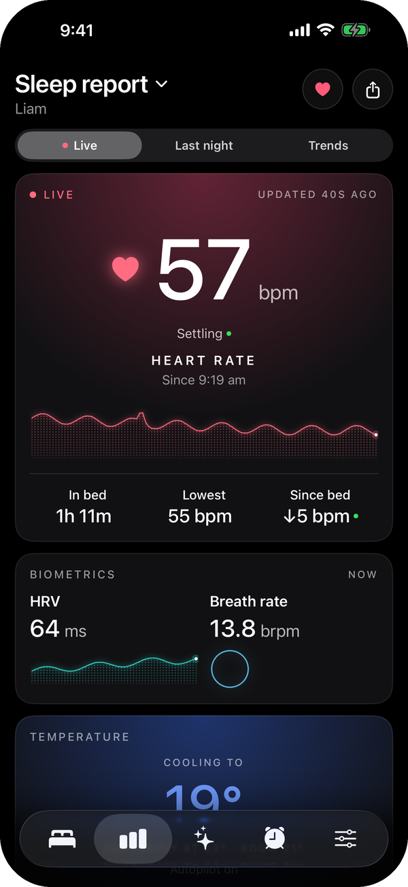
  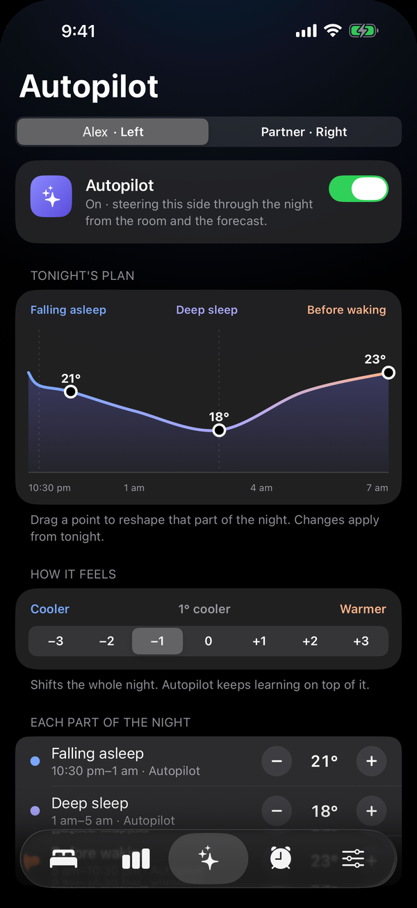
  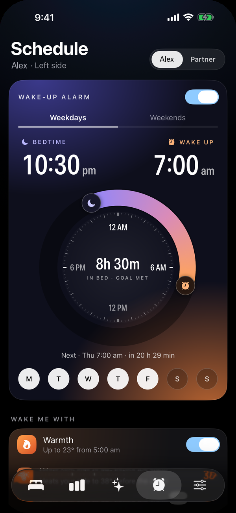
  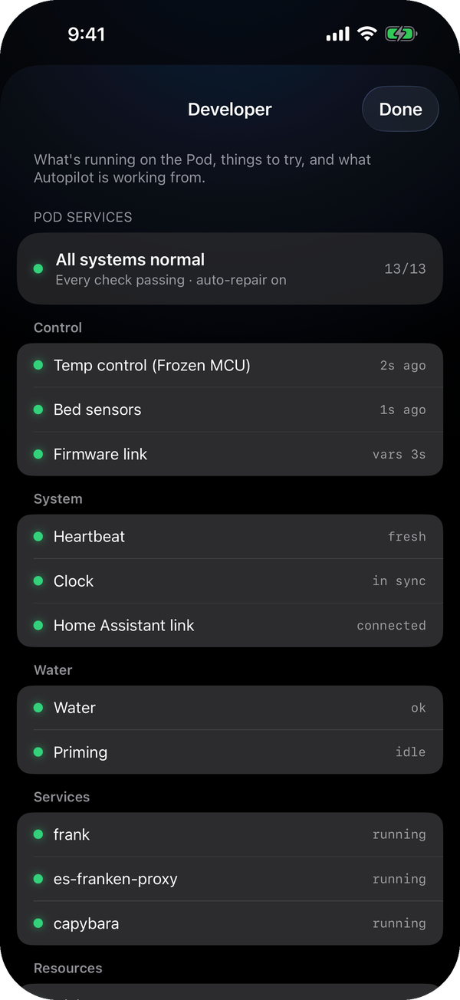
</p>

**Home Screen widgets**

<p align="center">
  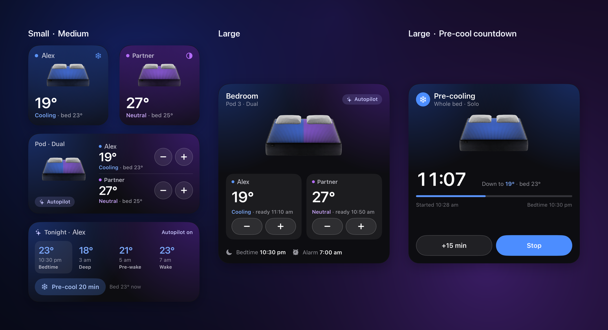
</p>

**Live Activities**

<p align="center">
  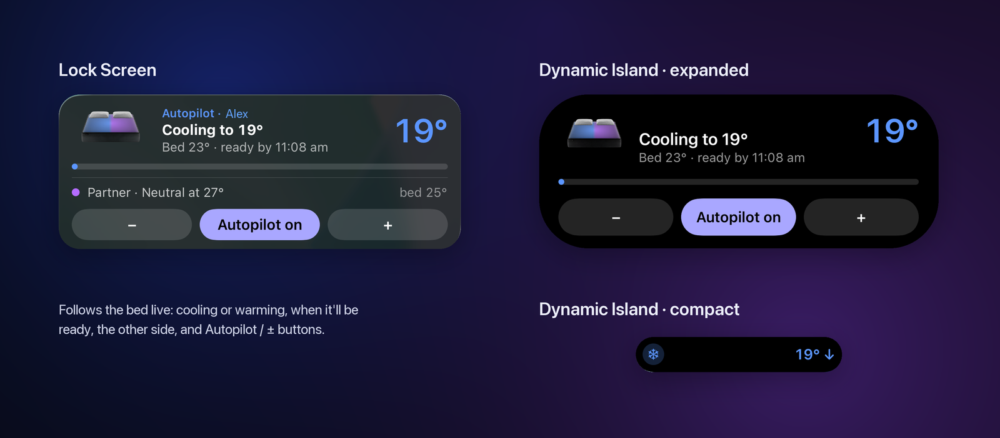
</p>

---

## Install

You need Home Assistant OS or Supervised (for the Home Assistant app), and your Pod already working in Home
Assistant through one of the three backends above.

### 1. Add the Eight+ Home Assistant app

[](https://my.home-assistant.io/redirect/supervisor_add_addon_repository/?repository_url=https%3A%2F%2Fgithub.com%2Fnexon3223%2Feight-plus)

Or go to **Settings → Apps → Install app → ⋮ → Repositories** (called *Add-ons → Add-on store* on Home Assistant
before 2026.11) and add `https://github.com/nexon3223/eight-plus`. Then install **Eight+** and start it. The first
start builds the app on your machine, which takes a few minutes.

### 2. Open Eight+ from the sidebar and follow the setup

See [the Home Assistant app](#2-the-eight-home-assistant-app-setup-wizard) above.

### 3. (Recommended) Get card updates through HACS

The Home Assistant app installs a bundled copy of the card, so everything works straight away. To get card updates
automatically, add this repository to HACS as a **Dashboard** repository: **HACS → ⋮ → Custom repositories** →
`https://github.com/nexon3223/eight-plus`, category **Dashboard**, then download **Eight+ card**. Eight+ switches
to the HACS copy on its next update.

## After install

- **Changing things** — use the card. Times, temperatures and Autopilot tuning are all helpers.
- **Updating** — when a new version changes Eight+'s YAML, the panel says so and **Apply update** rewrites the
  package. Your helper values, schedules and history stay.
- **Customising an automation** — copy it out of `packages/eight_plus/` into your own automations and switch the
  original off. Files in `packages/eight_plus/` are rewritten on update.
- **Uninstalling** removes the package, the Jinja model, the dashboard and the card resource Eight+ added.
  Backups in `eight_plus_backups/` and your sleep history stay.

## Where your data goes

Nowhere. Sleep reports are computed inside the Home Assistant app from what your Pod already reports to Home
Assistant, or optionally straight from the Pod over SSH. They're published back to Home Assistant over MQTT if
you have a broker, otherwise directly. The only traffic is between the app, your Home Assistant and, if you choose
SSH, your Pod.

## How it works

```
                    ┌──────────────── Home Assistant ────────────────┐
 Pod ──(cloud │ free-sleep │ gateway)──▶ climate · presence · vitals │
                    │                                                 │
                    │  packages/eight_plus/   helpers · Autopilot     │
                    │                         sensors · automations   │
                    │  Eight+ dashboard  ◀──  custom:eight-sleep-card │
                    └───────────▲───────────────────────▲─────────────┘
                                │ WS (Supervisor)       │ MQTT / REST
                    ┌───────────┴──── Eight+ app ───────┴─────────────┐
                    │ setup wizard (ingress)   sleep pipeline         │
                    │ Pod app :8098 (scoped)   collector → rollup →   │
                    └─────────────────────────────────── publish ─────┘
```

- **Detection** reads the entity registry and matches each integration's unique-ID scheme.
- **The generator** turns your answers into one package per sleeper, plus one for the bed. `tests/test_generator.py`
  renders every backend × solo/couple × feature mix and checks that the YAML parses, every Jinja template compiles
  and the Autopilot model returns sane numbers.
- **The pipeline** samples heart rate, HRV, breathing and debounced bed presence once a minute. It then segments
  the night, estimates stages and scores it. Against the high-fidelity raw-data pipeline over ten real nights, the
  median score difference is 6 points.

## How this was built, and who maintains it

Eight+ was built by one person ([@nexon3223](https://github.com/nexon3223)) for their own bed, using
[Claude Code](https://claude.com/claude-code) as a coding assistant. Commits it helped with say so. I review every
change, and the card, the Home Assistant app and the gateway run every night on my own Pod 3.

I maintain it. Bug reports with your backend, Home Assistant version and app log are very welcome — see
[Issues](https://github.com/nexon3223/eight-plus/issues).

## Development

```bash
pip install pyyaml jinja2
python3 tests/test_generator.py              # offline: every combination, YAML + Jinja + model
python3 tests/test_detect.py                 # backend detection against each integration's unique IDs
python3 -m http.server 8780                  # then open /tools/preview.html?source=cloud|freesleep|gateway
                                             # — the card against a mock Home Assistant, no HA needed
echo 'HA_URL=http://homeassistant.local:8123' > .dev.env   # gitignored
echo 'HA_TOKEN=<long-lived token>'           >> .dev.env
tools/dev.sh                                 # the panel on :8099 against your real HA, DRY RUN:
                                             # reads are real, every write is logged and skipped
```

The card and the gateway are developed in the maintainer's own repos and published here by `tools/sync_card.py`
and `tools/sync_gateway.py`. They swap one household's entity names and credentials for generic ones, and refuse
to write if any survive.

## Credits

- **[free-sleep](https://github.com/throwaway31265/free-sleep)** (throwaway31265 and contributors, MIT). The gateway
  roots the Pod with free-sleep's process. `gateway/biometrics-tap/biometrics/` is vendored from free-sleep and
  patched to run beside the stock firmware. The app's presence detection is a port of free-sleep's. Without
  free-sleep, none of the local side would exist.
- **[HeartPy](https://github.com/paulvangentcom/heartrate_analysis_python)** (Paul van Gent, MIT), carried in via
  free-sleep's biometrics.
- **[eight_sleep](https://github.com/lukas-clarke/eight_sleep)** (lukas-clarke, MIT) for the cloud backend, and
  the raw heating-level → °C table.
- **[hass-free-sleep](https://github.com/Mrtenz/hass-free-sleep)** (Mrtenz, MIT) for the free-sleep backend.
- **[Lucide](https://github.com/lucide-icons/lucide)** (ISC, with some icons from [Feather](https://github.com/feathericons/feather), MIT) for the card's icons.

MIT licensed — see [LICENSE](LICENSE) and [THIRD_PARTY_NOTICES.md](THIRD_PARTY_NOTICES.md).
